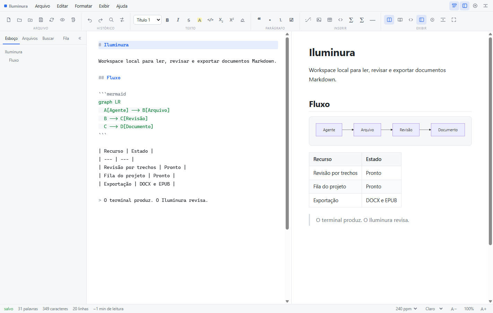
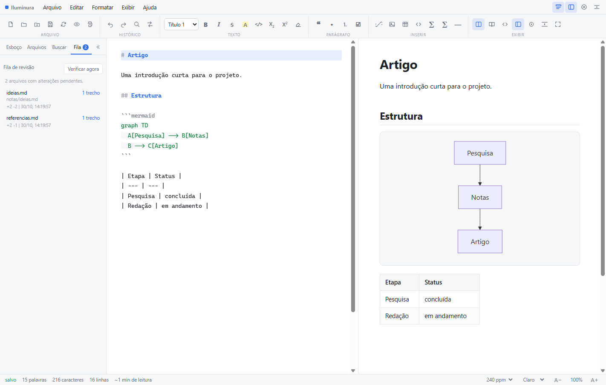
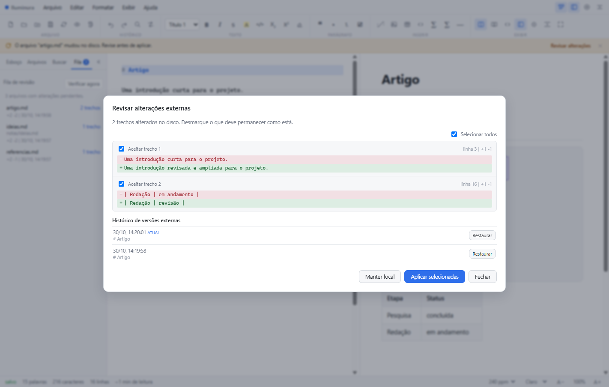

# Iluminura

[Português](README.md) · **English**

A local-first, self-contained web app for reading, writing, and rendering Markdown documents. Built in plain JavaScript, with a dependency-free core and a single optional library bundled locally for Mermaid diagrams.

Iluminura also ships a review workflow for external changes, designed for documents edited by AI agents in the terminal.


---

## Screenshots

### Interface



Split mode with toolbar, Markdown editor, rendered preview, and outline panel.

### Project review queue



Files changed in the project, with hunk count, added and removed lines, and detection time.

### Hunk-by-hunk review



Line diff grouped into hunks, individual selection, external version history, and actions to apply or keep the local version.

---

## Why

AI agents are good at editing Markdown in the terminal. Reviewing what they changed is the hard part: dozens of files, long diffs, and no safe way to accept only part of the result.

Iluminura is the visual layer for that loop. Open a folder, let the agent work, and review each change hunk by hunk before it lands in your document.

## Features

### Editor

- **Ribbon toolbar** with context groups (File, History, Text, Paragraph, Insert, View), shortcut hints, and active states.
- **Collapsible sidebar** with Outline, Files, Search, and Queue panels (`Ctrl+Shift+1`).
- **Adjustable split view** between editor and preview, with minimum widths on each side. Double-click resets to 50%; arrow keys adjust the focused divider.
- **Global search** across the open folder, accent-insensitive, with direct navigation to the matched passage.
- **Three view modes**: synchronized split, read-only reading mode, and raw source mode.
- **Outline** extracted from `H1`–`H6` headings and rendered as a live hierarchical index.
- **Live text metrics**: words, total characters, characters without spaces, lines, paragraphs, and configurable reading time (120, 240, or 382 words per minute).
- **Themes and typography**: Light, Dark, and Sepia, plus Sans Serif, Serif, and Monospace families.
- **Visual scale** from 60% to 200%.

### Writing engine

- **Real-time syntax highlighting** in an overlay synchronized with the editor.
- **Focus mode** (dims inactive paragraphs) and **Typewriter mode** (keeps the active line vertically centered).
- **Automatic pair closing** for `()`, `[]`, `{}`, quotes, backticks, `*`, `_`, `~`, and `$`.
- **List and block continuation**: automatic markers, task checkboxes, and blockquotes on new lines; double line break ends the block. Block indent and outdent with `Tab` and `Shift+Tab`.
- **Find and replace** with sequential navigation and single or global replacement.
- **Undo and redo** with typing grouping, covering formatting and replacements.
- **Temporary persistence** through browser local storage to reduce data loss.

### Markdown rendering

The built-in parser implements the common subset of CommonMark and GitHub Flavored Markdown:

- ATX (`#`) and Setext (`===`, `---`) headings.
- Inline formatting: bold, italic, strikethrough (`~~`), highlight (`==`), subscript (`~`), superscript (`^`), and inline code.
- Ordered, unordered, and interactive task lists.
- Blockquotes with nesting and standardized alert blocks (`NOTE`, `TIP`, `IMPORTANT`, `WARNING`, `CAUTION`).
- GFM tables with alignment delimiters (`:---`, `:---:`, `---:`).
- Code blocks with native syntax highlighting for JavaScript, TypeScript, Python, Go, Rust, Java, C, SQL, HTML, CSS, Shell, and YAML.
- **Mermaid diagrams**: ` ```mermaid ` blocks render as interactive SVG, with flowchart, sequence, class, state, ER, gantt, journey, and other diagram types. The theme follows the interface; invalid diagrams show the original code and the error without breaking the preview.
- Math via TeX inline (`$...$`) and block (`$$...$$`) expressions, converted internally to MathML/SVG.
- Footnotes (`[^1]`), YAML front matter (hidden from the preview), and thematic breaks (`<hr>`).
- Security: strict sanitization of arbitrary HTML and preventive blocking of executable URIs (`javascript:`).

### Reviewing external changes

- **Detection**: while a document is linked to disk, the reader watches for changes made by other programs, such as AI agents, using `FileSystemObserver` when available, a one-second timestamp check, a full content comparison every five seconds, and a check when the window regains focus.
- **Visible link state**: the status bar shows **linked: file**, **linked: folder**, or **unlinked**, and explains when automatic refresh is unavailable.
- **Modes**: review before applying (default), apply automatically, or do not refresh.
- **Hunk-by-hunk review**: each hunk can be accepted or rejected individually before applying.
- **Local protection**: when there are unsaved edits, the diff is read-only. Loading from disk discards those edits after confirmation; saving with a pending external version also asks for confirmation.
- **Saving and concurrency**: after saving, the app re-reads the file and compares it with what was written. If another program wrote in the meantime, the external version enters review instead of being adopted silently.
- **History**: external versions are stored locally, limited to 20 versions and 2 MB per document. A previous version can be restored into the editor as a local change.
- **Manual refresh**: the File menu, the Review button in the ribbon, and the disk notice open the review. `F5` still performs a direct reload.

### Project review queue

- **Folder monitoring**: when a folder is open, the reader indexes Markdown and text files and watches for external changes across the whole tree, using `FileSystemObserver` when available and periodic checks otherwise.
- **Indicator**: the Queue tab shows how many files have pending changes.
- **Items**: each item shows the relative path, hunk count, added and removed lines, and detection time.
- **Review**: clicking an item opens the file with the base version and the hunk diff. Applying or keeping the local version resolves the item and removes it from the queue.
- **Manual check**: the "Check now" button rescans the folder.
- **Modes**: in Apply automatically, base lines advance without pending items. In Review before applying and Do not refresh, changes stay in the queue.
- **Limits**: 600 files, 2 MB per file, 8 MB of total text, and depth 6. Removed files do not create review items. New files are listed as additions.

### Export

- **Standalone HTML**: compiled document with stylesheets, embedded Base64 images, and Mermaid diagrams already converted to SVG.
- **DOCX**: OOXML package with headings, paragraphs, lists, tables, links, code blocks, and images. Mermaid diagrams are rasterized to PNG before assembly.
- **EPUB**: EPUB 3 package with an XHTML chapter, heading table of contents, stylesheet, images, and Mermaid diagrams as inline SVG.
- **PDF**: output only from the rendered document, without toolbars, editor, or interface panels. Images are loaded and decoded before printing, diagrams render in the light theme, and page margins, breaks, colors, and code blocks are preserved.
- **Clipboard**: direct copy of the processed HTML markup.

### Local images and resources

- **Relative paths**: images such as `` resolve relative to the Markdown file, not the app page.
- **Folder linking**: when the document folder is open (or through the "Open document folder…" notice), the reader finds sibling images through the File System Access API and displays them without copying files.
- **Visual diagnostics**: missing images get a placeholder with the file name, and an actionable notice reports how many failed to load.
- **Standalone export**: resolved images are embedded as Base64 in the exported HTML, producing a single portable file.

### PWA and offline use

- **PWA install**: manifest and service worker allow installing the app and opening it offline after the first visit. The local cache is refreshed from the network when the server is available.
- **System tray**: the Iluminura shortcut keeps an icon in the Windows tray. Its menu opens the app, starts or stops the server, opens the app folder, and exits.
- **Server shutdown**: **Help > Shut down server…** asks for confirmation, warns about unsaved changes, and shuts down the local server. The option is disabled when the app runs without the integrated server.

## Install

### Windows

Run `instalar.bat` to create the **Iluminura** shortcut in the Start Menu. The shortcut points to `iniciar.vbs` through `wscript.exe`, starts the tray icon and the local server, and opens the browser. It uses `assets/icons/iluminura.ico`. No administrator rights are required; the shortcut is created in the user profile.

The server stays active in the background while the tray icon is present. Right-click the icon to open the app, start or stop the server, open the app folder, or exit. Closing the browser tab does not stop the server.

To remove the shortcut, run `desinstalar.bat`. Only the shortcut is removed; the project files are kept. If the app folder is moved, run `instalar.bat` again to update the path.

On Windows 11, the icon may land in the tray overflow area. Drag it to the visible area or use the hidden icons menu to keep it accessible.

### Any OS

```bash
node servidor.js [port]
```

The server writes its PID to `.iluminura.pid` and a shutdown token to `.iluminura.token`. It does not expose those files over the network. To stop it, use the tray menu or **Help > Shut down server…** in the interface. `parar.bat` remains available as a fallback when the interface is unreachable. On non-Windows systems, run `node servidor.js` and stop it with `Ctrl+C`.

### Static load

Open `index.html` directly. The app runs under the `file://` protocol. Persistence uses the traditional file picker (Blob/download) and Web Storage API (`localStorage`). PWA installation and the service worker do not work under this protocol.

## Using with AI agents

1. Open the project folder in Iluminura.
2. Confirm that the status bar shows **linked: file** or **linked: folder**. Without a link, automatic refresh does not work.
3. Keep the app open in a separate window or on another screen.
4. Run the agent in the development terminal.
5. When one or more files change, use the Queue tab to see pending items and the hunk review to accept or reject changes.
6. Use history to restore a previous external version, then save when you are happy with the result.

Iluminura does not replace the terminal or the agent. It provides the visual layer for reading, reviewing, and exporting that is missing from a command-line editing workflow.

## Keyboard shortcuts

| Action | Shortcut |
| --- | --- |
| New document | `Ctrl + N` |
| Open file | `Ctrl + O` |
| Save document | `Ctrl + S` |
| Undo | `Ctrl + Z` |
| Redo | `Ctrl + Y` or `Ctrl + Shift + Z` |
| Find in text | `Ctrl + F` |
| Replace in text | `Ctrl + H` |
| Search the folder | `Ctrl + Shift + G` |
| Bold | `Ctrl + B` |
| Italic | `Ctrl + I` |
| Insert link | `Ctrl + K` |
| Headings (levels 1 to 6) | `Ctrl + 1` to `Ctrl + 6` |
| Toggle source view | `Ctrl + /` |
| Toggle focus mode | `Ctrl + Shift + F` |
| Toggle sidebar | `Ctrl + Shift + 1` |
| Toggle toolbar | `Ctrl + Shift + T` |
| Reload from disk | `F5` |
| Insert code block | `Ctrl + Shift + K` |
| Insert math block | `Ctrl + Shift + M` |
| Print / export PDF | `Ctrl + P` |
| Show shortcut help | `F1` |

## Requirements and limitations

- **View model**: the interface uses a dual-panel architecture (text editor and render panel) or alternating views. It does not edit the rendered document in place.
- **Diagrams**: Mermaid is supported through a local copy of the official library (about 3.5 MB), loaded on demand only for documents with `mermaid` blocks. Other syntaxes, such as PlantUML, remain code blocks. Diagram theme follows the interface.
- **PWA and offline use**: the service worker requires a secure context such as `localhost` or HTTPS. The app opens offline after the first visit; the Mermaid library enters the cache after the first rendered diagram. Installation depends on browser support and permissions.
- **External change review**: the diff is line-based and grouped into hunks, not a semantic Markdown analysis. With pending local edits, review is read-only and applying the disk version requires confirmed discard. History is local, limited to 20 versions and 2 MB per document, and may be reduced if browser storage is full. Periodic checks pause while the tab is hidden or minimized and resume when focus returns.
- **Project review queue**: watches up to 600 files, 2 MB per file, 8 MB of total text, and depth 6. The queue is recalculated when the folder opens and does not represent file deletions. In automatic mode, base lines advance without review.
- **Global search**: folder scanning is limited to depth 6 and 800 entries, 24 MB of content, and 150 results. Hidden folders and `node_modules` are ignored.
- **DOCX and EPUB export**: conversion preserves textual structure, lists, tables, links, code blocks, images, and diagrams, but does not fully reproduce the preview CSS. Math formulas are exported as text and interactive diagram features are not kept.
- **Filesystem requirements**: recursive local directory management, relative image resolution, and external change synchronization depend on the File System Access API (available in Chromium-based browsers). Without it, relative images still depend on the path served by the browser.
- **System tray**: the icon and native shortcuts are Windows-only. On other systems, run `node servidor.js` and stop it with `Ctrl+C`. On Windows 11, the icon may land in the tray overflow area.
- **External refresh link**: synchronization requires a file or folder handle granted by the File System Access API. Documents opened through the classic file picker, a draft, or pasted content have no disk link. The status bar shows **unlinked** in those cases; open the file through the system picker or the folder to enable detection.
- **Highlight performance**: documents over 2,500 lines temporarily disable the editor highlight layer while typing to preserve frame rate and input responsiveness.

## Tests

```bash
node testes/markdown.test.js
node testes/caminhos.test.js
node testes/diff.test.js
node testes/servidor.test.js
node testes/bandeja.test.js
node testes/e2e/run.js
node testes/e2e/externo.js
node testes/e2e/servidor-ui.js
```

The unit suite covers parser assertions, relative path resolution, and line diff behavior. The server lifecycle test starts an isolated instance and validates PID and token handling, method, origin, host, and token rejection, control-file isolation, and shutdown. The tray test runs the PowerShell self-test on an isolated port and is Windows-only. The main E2E test requires Node.js 22 or newer and Chrome or Edge, and covers startup, PWA, Mermaid, undo and redo, global search, DOCX and EPUB export, printing, external change review, the project review queue, control-route cache exclusion, and offline opening. The external change test uses the server at `http://127.0.0.1:8731/` and simulates an agent writing to the file while the document is open and during saving. The shutdown interface test opens the app, triggers **Help > Shut down server…**, checks the unsaved changes warning, confirms shutdown, and validates that the option is disabled afterward. Set `CHROME_PATH` to point to the browser executable.

## License

MIT. See [LICENSE](LICENSE).

Mermaid diagrams use the official Mermaid 11.17.2 library, also distributed under the MIT License; the terms are in [assets/vendor/LICENSE-mermaid](assets/vendor/LICENSE-mermaid).
