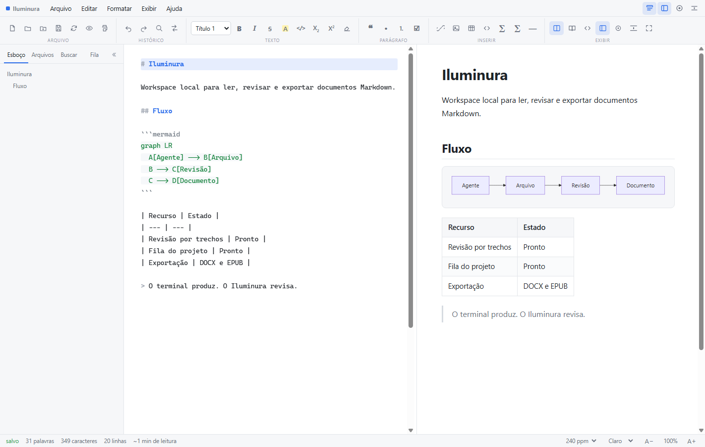
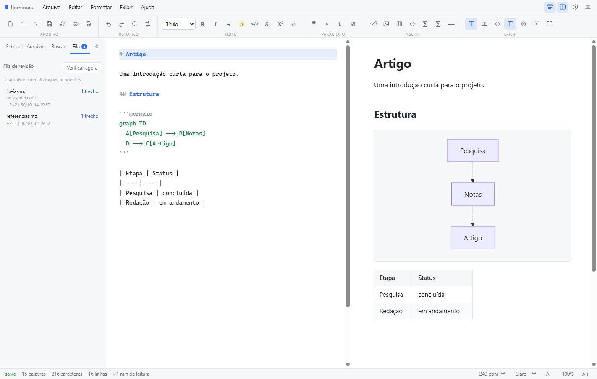
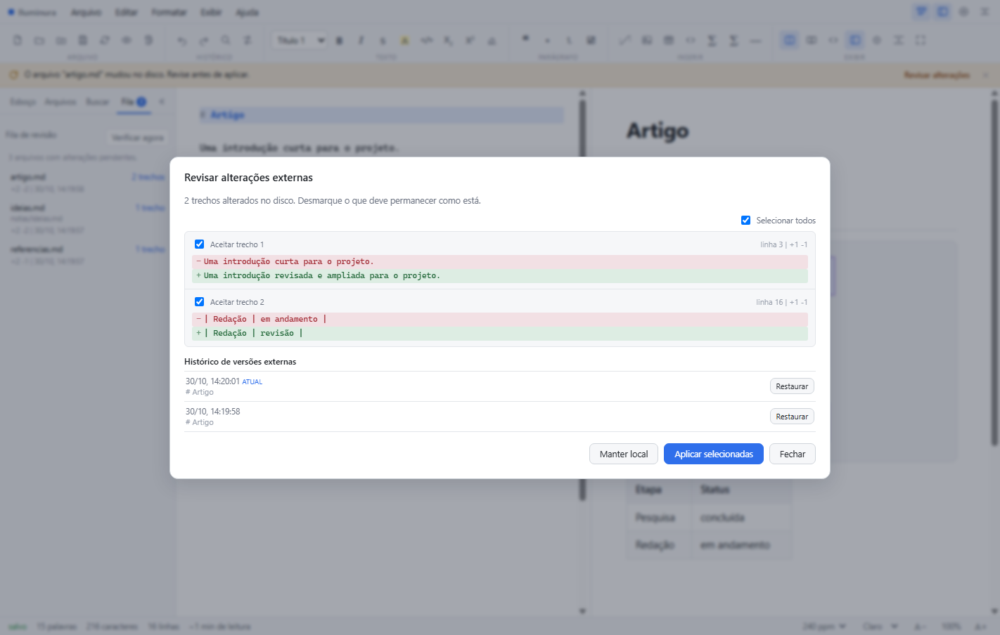

# Iluminura

[Português](README.md) · **English**

**Review visually the changes AI agents make to your Markdown documents.**

The agent keeps working in the terminal. Iluminura watches the files on disk and shows the changes in a reading and editing interface, so you can review each hunk and decide what to keep.

It also works as a local Markdown editor and reader, with live preview, document search, and export. Processing and documents stay on your computer. The app does not send documents to remote services or collect telemetry; the browser talks only to the local server.

## Quick start

Requires Node.js.

```bash
git clone https://github.com/samuel-c-santos/iluminura.git
cd iluminura
node servidor.js
```

Open [http://127.0.0.1:8731](http://127.0.0.1:8731) in the browser. In the interface, open `exemplo.md` to try the editor and the preview.

On Windows, you can also start the app with `iniciar.bat`. To create a Start Menu shortcut, run `instalar.bat`.

## Highlights

- Track changes made by AI agents or other programs and review them hunk by hunk.
- Edit Markdown with live preview, document search, and writing tools.
- Export documents to HTML, DOCX, EPUB, or PDF.

The app is implemented in JavaScript. Mermaid is bundled locally and loaded when a document contains diagrams.


---

## Screenshots

### Interface



Split mode with toolbar, Markdown editor, rendered preview, and outline panel.

### Project review queue



Files changed in the project, with hunk count, added and removed lines, and detection time.

### Hunk-by-hunk review



Line diff grouped into hunks, individual selection, external version history, and actions to apply or keep the local version.

---

## 1. Running and installing

Application processing and document storage happen locally. The HTTP server listens only on `127.0.0.1`. The project does not send documents to remote services, does not integrate cloud services, and does not collect telemetry. The Mermaid library is served locally and loaded only when the document contains diagrams.

### Execution architecture

The system can run through three methods:

| Method | Execution | Technical characteristics |
| --- | --- | --- |
| Integrated local server | Run `iniciar.bat` (or `iniciar.vbs`) | Starts the system tray icon, the background server, and the interface at `http://127.0.0.1:8731`. Enables full access to the File System Access API for direct handling of files and folders on disk. |
| Direct command line | `node servidor.js [port]` | Lets you follow the log in the terminal and customize the listening port of the local static HTTP service. |
| Static load | Open `index.html` directly | Runs under the `file://` protocol. Persistence uses the traditional file picker (Blob/download) and caching uses the Web Storage API (`localStorage`). PWA installation and the service worker do not work under this protocol. |

The launcher starts the Iluminura tray icon and the background server without a console window. The icon menu offers **Open Iluminura**, **Start server** or **Stop server**, **Open app folder**, and **Exit**. Running the shortcut while the app is already active opens the browser and keeps a single tray instance. If the port is taken by another program, a message box reports the conflict.

The server writes its PID to `.iluminura.pid` and a shutdown token to `.iluminura.token`. The server does not expose those files over the network. To stop it, use the tray menu or **Help > Shut down server…** in the interface. The command asks for confirmation, warns about unsaved changes, and shuts down the server through the local token. `parar.bat` remains available as a fallback when the interface is unreachable.

### Windows installation

Run `instalar.bat` to create the **Iluminura** shortcut in the Start Menu. The shortcut points to `iniciar.vbs` through `wscript.exe`, starts the tray icon and the local server, and opens the browser. It uses `assets/icons/iluminura.ico`. No administrator rights are required; the shortcut is created in the user profile.

The server stays active in the background while the tray icon is present. Right-click the icon to open the app, start or stop the server, open the app folder, or exit. The **Exit** option shuts down the server and removes the icon. Closing the browser tab does not stop the server.

On Windows 11, the icon may land in the tray overflow area. Drag it to the visible area or use the hidden icons menu to keep it always accessible.

**Help > Shut down server…** in the app also stops the server. In that case, the tray icon remains available and can start the server again. To remove the shortcut, run `desinstalar.bat`; the removal deletes only the shortcut, not the project files. If the app folder is moved, run `instalar.bat` again to update the path.

PWA installation through the browser remains available under Help > Install app. It creates a browser-managed shortcut; `instalar.bat` creates the native shortcut that starts and keeps the local server running.

---

## 2. Functional specification

### 2.1 Interface and operating modes
- **Ribbon toolbar**: commands organized by context (File, History, Text, Paragraph, Insert, and View), in the style of an office ribbon, with icons, shortcut hints, and active states.
- **Collapsible sidebar**: the Outline, Files, Search, and Queue panel can be collapsed by the button in the panel itself, by the header, or with `Ctrl+Shift+1`; a discreet tab on the edge reopens the panel.
- **File navigation**: the Files tab lists the `.md` and `.txt` documents in the open folder. Use **Expand folders** to reveal subfolders and **Refresh tree** to re-read files created or removed outside the app. When opening a single file, the browser does not expose the folder; use **Open document folder** to unlock the sibling files.
- **Adjustable split**: drag the center divider to resize editor and preview within minimum widths on each side; double-click restores 50% and the keyboard arrows adjust the focused divider.
- **Global search**: the Search tab finds text and file names across the open folder, accent-insensitive, with direct opening at the matched passage.
- **PWA install**: manifest and service worker allow installing the app and opening it offline after the first visit. The local cache is refreshed from the network when the server is available.
- **System tray**: the Iluminura shortcut keeps an icon in the Windows tray. The menu opens the app, starts or stops the server, opens the app folder, and exits.
- **Server shutdown**: **Help > Shut down server…** asks for confirmation, warns about unsaved changes, and shuts down the local server. The option is disabled when the app is opened without the integrated server.
- **View modes**: synchronized dual panel (Editor and Preview), exclusive Reading mode (with typographic formatting), and raw Source mode.
- **Document structure**: dynamic extraction and rendering of the hierarchical index (TOC) with support for `H1` to `H6` heading levels.
- **Text metrics**: real-time count of words, total characters, characters without spaces, lines, and paragraphs. Configurable reading time estimate (120, 240, or 382 words per minute).
- **Themes and typography**: three interface variants (Light, Dark, and Sepia) and three type families (Sans Serif, Serif, and Monospace).
- **Scaling**: configurable visual scale from 60% to 200%.

### 2.2 Writing engine
- **Real-time syntax highlighting**: lexical highlight overlay synchronized with the edit field.
- **Writing modes**: Focus mode (visual dimming of inactive paragraphs) and Typewriter mode (continuous vertical anchoring of the active edit line in the center of the screen).
- **Input automation**: automatic closing of delimiter pairs (`()`, `[]`, `{}`, single and double quotes, backticks, `*`, `_`, `~`, `$`).
- **List and block handling**: automatic continuation of list markers, task checkboxes, and blockquotes when inserting line breaks; block ends on a double break. Block indent and outdent support (`Tab` and `Shift+Tab`).
- **Find and replace**: built-in text search module with sequential navigation and single or global replacement.
- **Edit history**: undo and redo (`Ctrl+Z`, `Ctrl+Y`, `Ctrl+Shift+Z`), available in the History ribbon, the Edit menu, and the buttons, with typing grouping and coverage of formatting and replacements.
- **Temporary persistence**: periodic automatic saving to browser local storage to contain data loss.

### 2.3 Markdown rendering specification
The built-in parser implements the common subset of the CommonMark and GitHub Flavored Markdown (GFM) specifications:
- ATX (`#`) and Setext (`===`, `---`) headings.
- Inline formatting: bold, italic, strikethrough (`~~`), highlight (`==`), subscript (`~`), superscript (`^`), and inline code.
- Ordered, unordered, and interactive task lists.
- Blockquotes with nesting support and standardized alert blocks (`NOTE`, `TIP`, `IMPORTANT`, `WARNING`, `CAUTION`).
- GFM tables with alignment delimiters (`:---`, `:---:`, `---:`).
- Code blocks with native syntax highlighting for the languages: JavaScript, TypeScript, Python, Go, Rust, Java, C, SQL, HTML, CSS, Shell, and YAML.
- **Mermaid diagrams**: ` ```mermaid ` blocks are rendered as interactive SVG, with support for flowchart, sequence, class, state, ER, gantt, journey, and other library diagrams. The theme follows the interface (light, dark, or sepia); invalid diagrams show the original code and the error message without breaking the preview.
- Math rendering: support for inline (`$...$`) and block (`$$...$$`) TeX expressions, processed through an internal math converter to MathML/SVG.
- Footnotes (`[^1]`), YAML front matter metadata (filtered from the preview), and thematic breaks (`<hr>`).
- Security: strict sanitization of arbitrary HTML and preventive blocking of executable URIs (`javascript:` scheme).

### 2.4 Images and local resources
- **Relative paths**: images such as `` are resolved relative to the Markdown file, not to the app page.
- **Folder link**: when the document folder is open (or through the "Open document folder…" notice), the reader finds sibling images through the File System Access API and displays them without copying files.
- **Visual diagnostics**: missing images get a placeholder with the file name, and an actionable notice reports how many failed to load.
- **Standalone export**: resolved images are embedded as Base64 in the exported HTML, producing a single portable file.

### 2.5 Reviewing external changes
- **Detection**: while the document is linked to disk, the reader watches for changes made by other programs, such as AI agents, using `FileSystemObserver` when available, a timestamp check every second, and a full content comparison every five seconds and when the window regains focus.
- **Visible link**: the status bar shows **linked: file**, **linked: folder**, or **unlinked**. The indicator explains when automatic refresh is unavailable and allows opening the file or the document folder with one click.
- **Modes**: the external changes preference offers three options: review before applying (default), apply automatically, or do not refresh.
- **Hunk-by-hunk review**: the "Review changes" notice opens a line diff grouped into hunks. Each hunk can be accepted or rejected individually before applying.
- **Local protection**: when there are unsaved edits, the diff is read-only. Loading from disk discards those edits after confirmation, and saving with a pending external version also asks for confirmation.
- **Saving and concurrency**: after saving, the app re-reads the file and compares it with what was written. If another program wrote in the meantime, the external version enters review instead of being adopted silently.
- **History**: external versions are recorded in local storage, limited to 20 versions and 2 MB per document. A previous version can be restored into the editor as a local change.
- **Manual refresh**: the File menu, the Review button in the ribbon, and the disk notice open the review. The `F5` key still performs a direct reload of the file.

### 2.6 Export
- **Standalone HTML**: compiled document containing stylesheets, embedded images (Base64 encoding), and Mermaid diagrams already converted to SVG.
- **DOCX**: OOXML package with headings, paragraphs, lists, tables, links, code blocks, and images. Mermaid diagrams are rasterized to PNG before assembly.
- **EPUB**: EPUB 3 package with an XHTML chapter, heading table of contents, stylesheet, images, and Mermaid diagrams as inline SVG.
- **PDF**: output exclusively from the rendered document, without toolbars, editor, or interface panels. Images are loaded and decoded before printing, diagrams are rendered in the light theme, and there are page margins, break control, and preservation of colors and code blocks.
- **Clipboard**: direct copy of the processed HTML markup to the system clipboard.

### 2.7 Project review queue
- **Folder monitoring**: when a folder is open, the reader indexes Markdown and text files and watches for external changes across the whole tree, with `FileSystemObserver` when available and periodic checks as a fallback.
- **Indicator**: the Queue tab shows how many files have pending changes.
- **Items**: each item shows the relative path, the hunk count, the added and removed lines, and the detection time.
- **Review**: clicking an item opens the file with the base version and the hunk diff. Applying or keeping the local version resolves the item and removes it from the queue.
- **Manual check**: the "Check now" button rescans the folder.
- **Modes**: in Apply automatically, base lines advance without creating pending items. In Review before applying and Do not refresh, changes stay in the queue.
- **Limits**: 600 files, 2 MB per file, 8 MB of total text, and depth 6. Removed files do not create review items. New files are listed as additions.

### 2.8 Workflow with AI agents
The main Iluminura workflow is to follow documents changed by AI agents running in the terminal:

1. Open the project folder in Iluminura.
2. Confirm in the status bar that the document shows **linked: file** or **linked: folder**. Without a link, automatic refresh does not work.
3. Keep the app open in a separate window or on another screen.
4. Run the agent in the development environment terminal.
5. When one or more files change, use the Queue tab to see pending items and the hunk review to accept or reject the changes.
6. Use the history to restore a previous external version and save the result when you are happy with it.

The app does not replace the terminal or the agent. It provides the visual layer for reading, reviewing, and exporting that is missing from the command-line editing workflow.

---

## 3. Keyboard shortcuts

| Action | Shortcut |
| --- | --- |
| New document | `Ctrl + N` |
| Open file | `Ctrl + O` |
| Save document | `Ctrl + S` |
| Undo | `Ctrl + Z` |
| Redo | `Ctrl + Y` or `Ctrl + Shift + Z` |
| Find in text | `Ctrl + F` |
| Replace in text | `Ctrl + H` |
| Search the folder | `Ctrl + Shift + G` |
| Bold | `Ctrl + B` |
| Italic | `Ctrl + I` |
| Insert link | `Ctrl + K` |
| Headings (levels 1 to 6) | `Ctrl + 1` to `Ctrl + 6` |
| Toggle source view | `Ctrl + /` |
| Toggle focus mode | `Ctrl + Shift + F` |
| Toggle sidebar | `Ctrl + Shift + 1` |
| Adjust panel split | `←` / `→` with the divider focused |
| Toggle toolbar | `Ctrl + Shift + T` |
| Reload from disk | `F5` |
| Insert code block | `Ctrl + Shift + K` |
| Insert math block | `Ctrl + Shift + M` |
| Print / export PDF | `Ctrl + P` |
| Show shortcut help | `F1` |

---

## 4. Repository structure

```
iluminura/
├── index.html              User interface and panel structure
├── manifest.webmanifest    Web app installation metadata
├── sw.js                   Cache and offline service worker
├── assets/
│   ├── markdown.js         Parser, AST generator, and highlight engine
│   ├── caminhos.js         Safe resolution of relative image paths
│   ├── diff.js             Line diff for external change review
│   ├── app.js              State, folder indexing, review, and file handling
│   ├── exportar.js         DOCX and EPUB package generation in the browser
│   ├── style.css           Layout rules, theme variables, and print directives
│   ├── logo.svg            Vector visual identifier
│   ├── docs/               Screenshots used in the documentation
│   ├── icons/              192 and 512 pixel install icons and .ico icon for Windows
│   └── vendor/
│       ├── mermaid.min.js  Optional diagram library, loaded on demand
│       └── LICENSE-mermaid MIT license of the Mermaid library
├── servidor.js             Minimal local HTTP server with no external modules
├── iniciar.bat             Starts the tray and the server through Windows Script Host
├── iniciar.vbs             Hidden launcher that opens the system tray icon
├── bandeja.ps1             Tray icon, control menu, and server lifecycle
├── parar.bat               Shutdown fallback when the interface is unreachable
├── encerrar.js             Token-authenticated shutdown with PID verification
├── instalar.bat            Creates the Iluminura Start Menu shortcut
├── instalar.ps1            PowerShell implementation of the shortcut installer
├── desinstalar.bat         Removes the Start Menu shortcut
├── desinstalar.ps1         PowerShell implementation of the shortcut removal
├── .gitignore              Ignores control files and run logs
├── exemplo.md              Syntax validation and reference document
├── testes/
│   ├── markdown.test.js    Automated test suite for the parser
│   ├── caminhos.test.js    Relative path resolution tests
│   ├── diff.test.js        Line diff tests
│   ├── servidor.test.js    Server lifecycle and authenticated shutdown
│   ├── bandeja.test.js     Tray and server cycle self-test
│   └── e2e/
│       ├── run.js          Browser integration tests
│       ├── externo.js      External changes during use and during saving
│       └── servidor-ui.js  Server shutdown through the interface
└── LICENSE                 MIT license terms
```

---

## 5. Verification and tests

The integrity of the lexical and syntactic analysis engine is validated through a unit test suite run in a Node.js environment:

```bash
node testes/markdown.test.js
node testes/caminhos.test.js
node testes/diff.test.js
node testes/servidor.test.js
node testes/bandeja.test.js
node testes/e2e/run.js
node testes/e2e/externo.js
node testes/e2e/servidor-ui.js
```

The unit routine evaluates 31 parser assertions, covering block processing, inline rules, GFM tables, math rendering, Mermaid blocks, sanitization against script injection, and isolation of malicious links, plus 15 relative path resolution assertions and 15 line diff assertions.

The server lifecycle test starts an isolated instance, validates PID and token, rejects invalid methods, origins, hosts, and tokens, confirms that the control files are not served over the network, shuts down the process, and verifies that a foreign PID is not affected. There are 17 checks.

The tray test runs the PowerShell script self-test on an isolated port: it starts the server, checks the status, creates the icon, shuts down, and validates that the process has ended. The test is Windows-only and is skipped on other systems.

The main E2E test requires Node.js 22 or newer and Chrome or Edge installed. It starts a temporary local server, opens the browser in headless mode, and verifies startup, PWA, Mermaid, undo and redo, global search, DOCX and EPUB export, printing, external change review, the project review queue, exclusion of control routes from the cache, and offline opening. There are currently 41 checks.

The external changes test uses the server at `http://127.0.0.1:8731/` and simulates an agent writing to the file while the document is open and during saving. It also checks the link indicator in the status bar.

The shutdown interface test starts an isolated server, opens the app, triggers **Help > Shut down server…**, checks the unsaved changes warning, confirms the shutdown, and validates that the option is disabled afterward. The browser executable can be set through the `CHROME_PATH` variable.

---

## 6. Technical limitations and scope

- **View model**: the interface uses a dual-panel architecture (text editor and render panel) or alternating views, not direct *in-place* editing of the rendered document.
- **Diagrams**: Mermaid is supported through a local copy of the official library (about 3.5 MB), loaded on demand only for documents with `mermaid` blocks. Other syntaxes, such as PlantUML, remain code blocks. The diagram theme follows the interface.
- **PWA and offline use**: the service worker requires a secure context, such as `localhost` or HTTPS. The app opens offline after the first visit; the Mermaid library enters the cache after the first rendered diagram. Installation depends on browser support and permissions.
- **External change review**: the diff is line-based and grouped into hunks, not a semantic Markdown analysis. With pending local edits, review is read-only and applying the disk version requires confirmed discard. History is local, limited to 20 versions and 2 MB per document, and may be reduced if browser storage is full. Periodic checks pause while the tab is hidden or minimized and resume when focus returns.
- **Project review queue**: watches up to 600 files, 2 MB per file, 8 MB of total text, and depth 6. The queue is recalculated when the folder opens and does not represent file deletions. In automatic mode, base lines advance without review.
- **Global search**: folder scanning is limited to depth 6 and 800 entries, 24 MB of content, and 150 results. Hidden folders and `node_modules` are ignored.
- **DOCX and EPUB export**: conversion preserves textual structure, lists, tables, links, code blocks, images, and diagrams, but does not fully reproduce the preview CSS. Math formulas are exported as text and interactive diagram features are not kept.
- **Filesystem requirements**: recursive local directory management, relative image resolution, and external change synchronization depend on compatibility with the File System Access API (available in Chromium-based browsers). Without it, relative images still depend on the path served by the browser.
- **System tray**: the icon and native shortcuts are Windows-only. On other systems, run `node servidor.js` and stop it with `Ctrl+C`. On Windows 11, the icon may land in the tray overflow area.
- **External refresh link**: synchronization requires a file or folder handle granted by the File System Access API. Documents opened through the classic file picker, as a draft, or from pasted content have no disk link. The status bar shows **unlinked** in those cases; open the file through the system picker or the folder to enable detection.
- **Highlight performance**: documents that exceed the 2,500 line threshold have the editor highlight layer temporarily disabled while typing to preserve frame rate and input responsiveness.

---

## 7. License

This project is distributed under the terms of the MIT License. See the [LICENSE](LICENSE) file for more information.

The Mermaid diagrams use the official Mermaid 11.17.2 library, also distributed under the MIT License; the terms are in [assets/vendor/LICENSE-mermaid](assets/vendor/LICENSE-mermaid).
