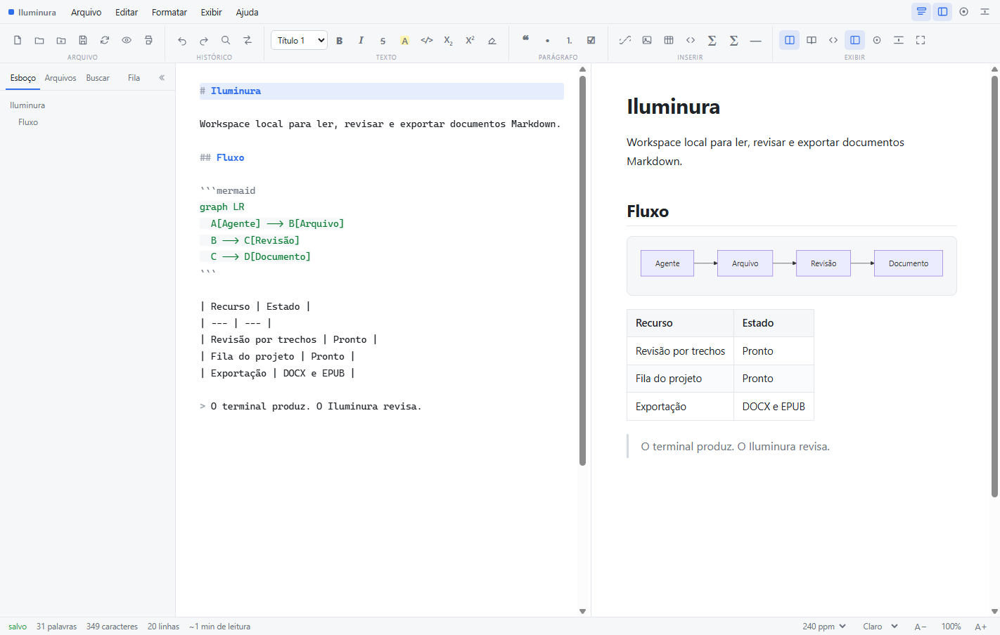
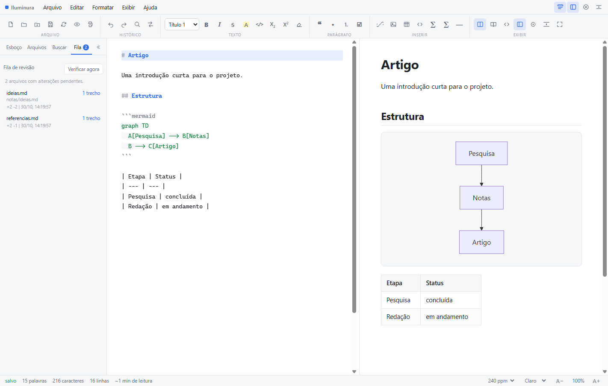
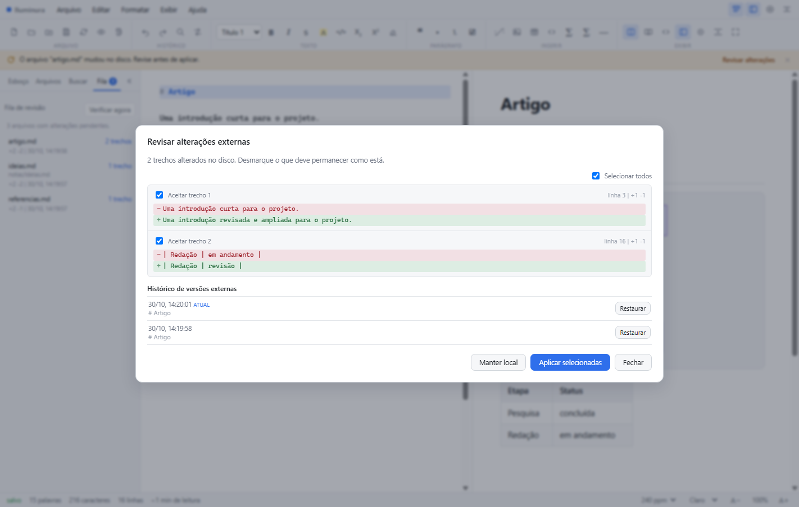

# Iluminura

Aplicativo web local e autônomo para leitura, escrita e renderização de documentos Markdown. Implementado em JavaScript puro, com o núcleo sem dependências e uma única biblioteca opcional empacotada localmente para diagramas Mermaid.

O projeto inclui um fluxo de revisão de alterações externas, pensado para documentos editados por agentes de IA no terminal.


---

## Capturas

### Interface



Modo dividido com faixa de ferramentas, editor Markdown, pré-visualização renderizada e painel de esboço.

### Fila de revisão do projeto



Arquivos alterados no projeto, com número de trechos, linhas adicionadas e removidas e horário da detecção.

### Revisão por trechos



Diff por trechos, seleção individual, histórico de versões externas e ações para aplicar ou manter a versão local.

---

## 1. Visão Geral

O **Iluminura** opera inteiramente no ambiente do cliente (navegador web), mantendo o processamento e o armazenamento de arquivos no sistema local do usuário. O projeto não realiza requisições de rede, telemetria ou integração com serviços em nuvem. A biblioteca Mermaid é servida localmente e carregada apenas quando o documento contém diagramas.

### Arquitetura de Execução

O sistema pode ser executado através de três métodos:

| Método | Execução | Características Técnicas |
| --- | --- | --- |
| Servidor local integrado | Executar `iniciar.bat` (ou `iniciar.vbs`) | Inicia o servidor em segundo plano, sem janela de console, e abre a interface em `http://127.0.0.1:8731`. Habilita acesso completo à File System Access API para manipulação direta de arquivos e pastas no disco. |
| Linha de comando direta | `node servidor.js [porta]` | Permite acompanhar o log no terminal e customizar a porta de escuta do serviço HTTP estático local. |
| Carregamento estático | Abrir `index.html` diretamente | Execução em protocolo `file://`. A persistência opera via seletor tradicional de arquivos (Blob/download) e cache via Web Storage API (`localStorage`). A instalação PWA e o service worker não funcionam nesse protocolo. |

O launcher oculto grava o PID em `.iluminura.pid` e um token de encerramento em `.iluminura.token`. O servidor não expõe esses arquivos pela rede. Ao executar `iniciar.bat` com o servidor já ativo, o Iluminura detecta a instância existente e abre o navegador no endereço atual. Se a porta estiver ocupada por outro programa, uma caixa de mensagem informa o conflito.

Para encerrar, execute `parar.bat` ou o atalho **Encerrar Iluminura** no Menu Iniciar. O comando usa o token para desligar o servidor e, se necessário, confirma o processo pelo PID antes de encerrá-lo.

### Instalação no Windows

Execute `instalar.bat` para criar dois atalhos no Menu Iniciar: **Iluminura** e **Encerrar Iluminura**. O primeiro aponta para `iniciar.vbs` por meio de `wscript.exe` e não abre janela de console; o segundo executa `parar.bat`. Ambos usam o ícone `assets/icons/iluminura.ico`. Não é necessário executar como administrador; os atalhos são criados no perfil do usuário.

O servidor permanece ativo em segundo plano enquanto o navegador estiver em uso. `parar.bat` encerra o processo de forma direta e remove os arquivos de controle. Para remover os atalhos, execute `desinstalar.bat`. A remoção apaga apenas os atalhos, não os arquivos do projeto. Se a pasta do aplicativo for movida, execute `instalar.bat` novamente para atualizar o caminho.

A instalação PWA pelo navegador continua disponível em Ajuda > Instalar aplicativo. Ela cria um atalho gerenciado pelo navegador; o `instalar.bat` cria atalhos nativos que iniciam e encerram o servidor local.

---

## 2. Especificação Funcional

### 2.1 Interface e Modos de Operação
- **Barra de Ferramentas em Faixas**: comandos organizados por contexto (Arquivo, Histórico, Texto, Parágrafo, Inserir e Exibir), no estilo de uma faixa de escritório, com ícones, dicas de atalho e estados ativos.
- **Barra Lateral Recolhível**: o painel de Esboço, Arquivos, Buscar e Fila pode ser recolhido pelo botão no próprio painel, pelo cabeçalho ou por `Ctrl+Shift+1`; uma aba discreta na borda reabre o painel.
- **Navegação de Arquivos**: a aba Arquivos lista os documentos `.md` e `.txt` da pasta aberta. Use **Expandir pastas** para revelar subpastas e **Atualizar árvore** para reler arquivos criados ou removidos fora do aplicativo. Ao abrir um único arquivo, o navegador não expõe a pasta; use **Abrir pasta do documento** para liberar os arquivos irmãos.
- **Divisão Ajustável**: arraste o divisor central para redimensionar editor e pré-visualização dentro de limites mínimos de cada lado; duplo clique restaura 50% e as setas do teclado ajustam o divisor focado.
- **Busca Global**: a aba Buscar localiza texto e nomes de arquivo em toda a pasta aberta, com busca sem acentos e abertura direta no trecho encontrado.
- **Instalação PWA**: manifesto e service worker permitem instalar o aplicativo e abri-lo offline após a primeira visita. O cache local é atualizado pela rede quando o servidor está disponível.
- **Modos de Exibição**: Painel duplo sincronizado (Editor e Pré-visualização), modo exclusivo de Leitura (com formatação tipográfica) e modo Código-Fonte puro.
- **Estruturação de Documento**: Extração e renderização dinâmica do índice hierárquico (TOC) com suporte a níveis de cabeçalho `H1` a `H6`.
- **Métricas Textuais**: Contagem em tempo real de palavras, caracteres totais, caracteres sem espaço, linhas e parágrafos. Estimativa de tempo de leitura configurável (120, 240 ou 382 palavras por minuto).
- **Temas e Tipografia**: Três variantes de interface (Claro, Escuro e Sépia) e três famílias tipográficas (Sem Serifa, Serifada e Monoespaçada).
- **Dimensionamento**: Escala visual configurável de 60% a 200%.

### 2.2 Motor de Edição
- **Realce Sintático em Tempo Real**: Overlay de realce léxico sincronizado com o campo de edição.
- **Mecanismos de Escrita**: Modo Foco (atenuação visual de parágrafos inativos) e Modo Máquina de Escrever (ancoragem vertical contínua da linha de edição ativa no centro da tela).
- **Automação de Entrada**: Fechamento automático de pares delimitadores (`()`, `[]`, `{}`, aspas simples e duplas, crases, `*`, `_`, `~`, `$`).
- **Manipulação de Listas e Blocos**: Continuação automática de marcadores de lista, caixas de seleção de tarefas e blocos de citação ao inserir quebras de linha; encerramento de bloco mediante quebra dupla. Suporte a indentação e desindentação em bloco (`Tab` e `Shift+Tab`).
- **Busca e Substituição**: Módulo integrado de busca textual com navegação sequencial e substituição individual ou global.
- **Histórico de Edição**: desfazer e refazer (`Ctrl+Z`, `Ctrl+Y`, `Ctrl+Shift+Z`), disponível na faixa Histórico, no menu Editar e pelos botões, com agrupamento de digitação e cobertura de formatação e substituições.
- **Persistência Temporária**: Salvamento periódico automático no armazenamento local do navegador para contenção de perda de dados.

### 2.3 Especificação de Renderização Markdown
O analisador sintático integrado implementa o subconjunto comum das especificações CommonMark e GitHub Flavored Markdown (GFM):
- Cabeçalhos ATX (`#`) e Setext (`===`, `---`).
- Formatação em linha: negrito, itálico, tachado (`~~`), realce (`==`), subscrito (`~`), sobrescrito (`^`) e código em linha.
- Listas ordenadas, não ordenadas e listas de verificação (*task lists* interativas).
- Citações em bloco com suporte a aninhamento e blocos de alerta padronizados (`NOTE`, `TIP`, `IMPORTANT`, `WARNING`, `CAUTION`).
- Tabelas GFM com delimitadores de alinhamento (`:---`, `:---:`, `---:`).
- Blocos de código com realce de sintaxe nativo para as linguagens: JavaScript, TypeScript, Python, Go, Rust, Java, C, SQL, HTML, CSS, Shell e YAML.
- **Diagramas Mermaid**: blocos ` ```mermaid ` são renderizados como SVG interativo, com suporte a flowchart, sequence, class, state, ER, gantt, journey e outros diagramas da biblioteca. O tema acompanha a interface (claro, escuro ou sépia); diagramas inválidos exibem o código original e a mensagem de erro sem quebrar a pré-visualização.
- Renderização matemática: suporte a expressões TeX em linha (`$...$`) e em bloco (`$$...$$`), processadas via conversor matemático interno para MathML/SVG.
- Notas de rodapé (`[^1]`), metadados YAML front matter (filtrados da visualização) e separadores temáticos (`<hr>`).
- Segurança: sanitização estrita de HTML arbitrário e bloqueio preventivo de URIs executáveis (esquema `javascript:`).

### 2.4 Imagens e Recursos Locais
- **Caminhos Relativos**: imagens como `` são resolvidas em relação ao arquivo Markdown, e não à página do aplicativo.
- **Vínculo com a Pasta**: ao abrir a pasta do documento (ou usar o aviso “Abrir pasta do documento…”), o leitor localiza as imagens irmãs pela File System Access API e as exibe sem copiar arquivos.
- **Diagnóstico Visual**: imagens ausentes recebem um espaço reservado com o nome do arquivo, e um aviso acionável indica quantas não foram carregadas.
- **Exportação Autônoma**: imagens resolvidas são embutidas em Base64 no HTML exportado, produzindo um arquivo único e portátil.

### 2.5 Revisão de Alterações Externas
- **Detecção**: enquanto o documento está vinculado ao disco, o leitor observa alterações feitas por outros programas, como agentes de IA, usando `FileSystemObserver` quando disponível, verificação de carimbo a cada segundo e comparação integral do conteúdo a cada cinco segundos e ao retornar o foco para a janela.
- **Vínculo Visível**: a barra de status mostra **vínculo: arquivo**, **vínculo: pasta** ou **sem vínculo**. O indicador explica quando a atualização automática está indisponível e permite abrir o arquivo ou a pasta do documento com um clique.
- **Modos**: a preferência de alterações externas oferece três opções: revisar antes de aplicar (padrão), aplicar automaticamente ou não atualizar.
- **Revisão por Trecho**: o aviso “Revisar alterações” abre um diff de linhas agrupado em trechos. Cada trecho pode ser aceito ou rejeitado individualmente antes da aplicação.
- **Proteção Local**: quando existem edições não salvas, o diff é somente leitura. Carregar o disco descarta essas edições após confirmação, e salvar com uma versão externa pendente também pede confirmação.
- **Salvamento e Concorrência**: depois de salvar, o aplicativo relê o arquivo e compara com o conteúdo gravado. Se outro programa tiver escrito no intervalo, a versão externa entra na revisão em vez de ser adotada silenciosamente.
- **Histórico**: versões externas são registradas no armazenamento local, com limite de 20 versões e 2 MB por documento. Uma versão anterior pode ser restaurada no editor como alteração local.
- **Atualização Manual**: o menu Arquivo, o botão Revisar na faixa e o aviso de disco abrem a revisão. A tecla `F5` continua executando a recarga direta do arquivo.

### 2.6 Exportação
- **HTML Autônomo**: Documento compilado contendo folhas de estilo, imagens embutidas (codificação Base64) e diagramas Mermaid já convertidos em SVG.
- **DOCX**: Pacote OOXML com títulos, parágrafos, listas, tabelas, links, blocos de código e imagens. Diagramas Mermaid são rasterizados para PNG antes da montagem.
- **EPUB**: Pacote EPUB 3 com capítulo XHTML, sumário de títulos, folha de estilo, imagens e diagramas Mermaid em SVG inline.
- **PDF**: Saída exclusivamente do documento renderizado, sem barras, editor ou painéis da interface. As imagens são carregadas e decodificadas antes da impressão, os diagramas são renderizados no tema claro e há margens de página, controle de quebras e preservação de cores e blocos de código.
- **Transferência**: Cópia direta da marcação HTML processada para a área de transferência do sistema.

### 2.7 Fila de Revisão do Projeto
- **Monitoramento da Pasta**: ao abrir uma pasta, o leitor indexa os arquivos Markdown e texto e acompanha alterações externas em toda a árvore, com `FileSystemObserver` quando disponível e verificação periódica como alternativa.
- **Indicador**: a aba Fila exibe a quantidade de arquivos com alterações pendentes.
- **Itens**: cada item mostra o caminho relativo, o número de trechos, as linhas adicionadas e removidas e o horário da detecção.
- **Revisão**: clicar em um item abre o arquivo com a versão de base e o diff por trechos. Aplicar ou manter local resolve o item e o remove da fila.
- **Verificação Manual**: o botão “Verificar agora” refaz a varredura da pasta.
- **Modos**: em Aplicar automaticamente, as linhas de base avançam sem gerar pendências. Em Revisar antes de aplicar e Não atualizar, as alterações permanecem na fila.
- **Limites**: 600 arquivos, 2 MB por arquivo, 8 MB de texto total e profundidade 6. Arquivos removidos não geram item de revisão. Arquivos novos são listados como adições.

### 2.8 Cenário de Uso com Agentes
O fluxo principal do Iluminura é acompanhar documentos alterados por agentes de IA executados no terminal:

1. Abra a pasta do projeto no Iluminura.
2. Confirme na barra de status que o documento mostra **vínculo: arquivo** ou **vínculo: pasta**. Sem vínculo, a atualização automática não funciona.
3. Mantenha o aplicativo aberto em uma janela separada ou em outra tela.
4. Execute o agente no terminal do ambiente de desenvolvimento.
5. Quando um ou mais arquivos mudarem, use a aba Fila para ver os pendentes e a revisão por trechos para aceitar ou rejeitar as alterações.
6. Use o histórico para restaurar uma versão externa anterior e salve o resultado quando estiver de acordo.

O aplicativo não substitui o terminal nem o agente. Ele oferece a camada visual de leitura, revisão e exportação que falta ao fluxo de edição por linha de comando.

---

## 3. Atalhos de Teclado

| Ação | Combinação |
| --- | --- |
| Novo documento | `Ctrl + N` |
| Abrir arquivo | `Ctrl + O` |
| Salvar documento | `Ctrl + S` |
| Desfazer | `Ctrl + Z` |
| Refazer | `Ctrl + Y` ou `Ctrl + Shift + Z` |
| Localizar no texto | `Ctrl + F` |
| Substituir no texto | `Ctrl + H` |
| Buscar na pasta | `Ctrl + Shift + G` |
| Aplicar negrito | `Ctrl + B` |
| Aplicar itálico | `Ctrl + I` |
| Inserir link | `Ctrl + K` |
| Cabeçalhos (Níveis 1 a 6) | `Ctrl + 1` até `Ctrl + 6` |
| Alternar visualização de código-fonte | `Ctrl + /` |
| Alternar modo foco | `Ctrl + Shift + F` |
| Alternar painel lateral | `Ctrl + Shift + 1` |
| Ajustar divisão dos painéis | `←` / `→` com o divisor focado |
| Alternar barra de ferramentas | `Ctrl + Shift + T` |
| Atualizar do disco | `F5` |
| Inserir bloco de código | `Ctrl + Shift + K` |
| Inserir bloco matemático | `Ctrl + Shift + M` |
| Imprimir / Exportar PDF | `Ctrl + P` |
| Exibir ajuda de atalhos | `F1` |

---

## 4. Estrutura do Repositório

```
iluminura/
├── index.html              Interface gráfica do usuário e estrutura dos painéis
├── manifest.webmanifest    Metadados de instalação do aplicativo web
├── sw.js                   Service worker de cache e funcionamento offline
├── assets/
│   ├── markdown.js         Analisador sintático, gerador de AST e motor de realce
│   ├── caminhos.js         Resolução segura de caminhos relativos de imagens
│   ├── diff.js             Diff de linhas para revisão de alterações externas
│   ├── app.js              Estado, indexação da pasta, revisão e manipulação de arquivos
│   ├── exportar.js         Geração de pacotes DOCX e EPUB no navegador
│   ├── style.css           Regras de layout, variáveis de tema e diretivas de impressão
│   ├── logo.svg            Identificador visual vetorial
│   ├── docs/               Capturas de tela usadas na documentação
│   ├── icons/              Ícones de instalação em 192 e 512 pixels e ícone .ico para o Windows
│   └── vendor/
│       ├── mermaid.min.js  Biblioteca opcional de diagramas, carregada sob demanda
│       └── LICENSE-mermaid Licença MIT da biblioteca Mermaid
├── servidor.js             Servidor HTTP local minimalista sem módulos externos
├── iniciar.bat             Inicia o servidor em segundo plano pelo Windows Script Host
├── iniciar.vbs             Launcher oculto que executa o servidor sem janela de console
├── parar.bat               Encerra o servidor local e remove os arquivos de controle
├── encerrar.js             Encerramento autenticado por token, com conferência de PID
├── instalar.bat            Cria os atalhos Iluminura e Encerrar Iluminura no Menu Iniciar
├── instalar.ps1            Implementação PowerShell do instalador dos atalhos
├── desinstalar.bat         Remove os atalhos do Menu Iniciar
├── desinstalar.ps1         Implementação PowerShell da remoção dos atalhos
├── .gitignore              Ignora os arquivos de controle do servidor
├── exemplo.md              Documento de validação de sintaxe e referência
├── testes/
│   ├── markdown.test.js    Suíte de testes automatizados do analisador
│   ├── caminhos.test.js    Testes de resolução de caminhos relativos
│   ├── diff.test.js        Testes do diff de linhas
│   ├── servidor.test.js    Ciclo de vida do servidor e encerramento autenticado
│   └── e2e/
│       ├── run.js          Testes de integração no navegador
│       └── externo.js      Alterações externas durante o uso e durante o salvamento
└── LICENSE                 Termos da licença MIT
```

---

## 5. Verificação e Testes

A integridade do motor de análise léxica e sintática é validada por meio de uma suíte de testes unitários executada em ambiente Node.js:

```bash
node testes/markdown.test.js
node testes/caminhos.test.js
node testes/diff.test.js
node testes/servidor.test.js
node testes/e2e/run.js
node testes/e2e/externo.js
```

A rotina unitária avalia 31 asserções do analisador, cobrindo processamento de blocos, regras de inline, tabelas GFM, renderização matemática, blocos Mermaid, sanitização contra injeção de script e isolamento de links maliciosos, 15 asserções de resolução de caminhos relativos e 15 asserções do diff de linhas.

O teste de ciclo de vida do servidor inicia uma instância isolada, valida PID e token, recusa métodos e tokens inválidos, confirma que os arquivos de controle não são servidos pela rede, encerra o processo e verifica que um PID estranho não é afetado. São 12 verificações.

O teste E2E principal requer Node.js 22 ou superior e Chrome ou Edge instalado. Ele inicia um servidor local temporário, abre o navegador em modo headless e verifica inicialização, PWA, Mermaid, desfazer e refazer, busca global, exportação DOCX e EPUB, impressão, revisão de alterações externas, fila de revisão do projeto e abertura offline. Atualmente são 40 verificações.

O teste de alterações externas usa o servidor em `http://127.0.0.1:8731/` e simula um agente gravando no arquivo enquanto o documento está aberto e durante o salvamento. Ele também confere o indicador de vínculo na barra de status. O executável do navegador pode ser indicado pela variável `CHROME_PATH`.

---

## 6. Limitações Técnicas e Escopo

- **Modelo de Visualização**: A interface utiliza arquitetura de painel duplo (editor de texto e painel de renderização) ou visualização alternada, não empregando edição direta *in-place* no documento renderizado.
- **Diagramas**: Mermaid é suportado por uma cópia local da biblioteca oficial (aprox. 3,5 MB), carregada sob demanda apenas em documentos com blocos `mermaid`. Outras sintaxes, como PlantUML, permanecem como blocos de código. O tema dos diagramas acompanha a interface.
- **PWA e Uso Offline**: o service worker exige contexto seguro, como `localhost` ou HTTPS. O aplicativo abre offline após a primeira visita; a biblioteca Mermaid entra no cache depois do primeiro diagrama renderizado. A instalação depende do suporte e das permissões do navegador.
- **Revisão de Alterações Externas**: o diff é feito por linhas agrupadas em trechos, não por análise semântica do Markdown. Com edições locais pendentes, a revisão é somente leitura e a aplicação do disco exige descarte confirmado. O histórico é local, limitado a 20 versões e 2 MB por documento, e pode ser reduzido se o armazenamento do navegador estiver cheio. A verificação periódica pausa com a aba oculta ou minimizada e é refeita ao retornar o foco.
- **Fila de Revisão do Projeto**: monitora até 600 arquivos, 2 MB por arquivo, 8 MB de texto total e profundidade 6. A fila é recalculada ao abrir a pasta e não representa exclusões de arquivos. No modo automático, as linhas de base avançam sem revisão.
- **Busca Global**: a varredura da pasta limita a profundidade a 6 níveis e o total a 800 entradas, 24 MB de conteúdo e 150 resultados. Pastas ocultas e `node_modules` são ignoradas.
- **Exportação DOCX e EPUB**: a conversão preserva a estrutura textual, listas, tabelas, links, blocos de código, imagens e diagramas, mas não reproduz integralmente o CSS da pré-visualização. Fórmulas matemáticas são exportadas como texto e recursos interativos de diagramas não são mantidos.
- **Requisitos de Sistema de Arquivos**: O gerenciamento recursivo de diretórios locais, a resolução de imagens relativas e a sincronização com alterações externas dependem da compatibilidade com a File System Access API (disponível em navegadores baseados no motor Chromium). Sem ela, imagens relativas continuam dependendo do caminho servido pelo navegador.
- **Vínculo para Atualização Externa**: a sincronização exige um identificador de arquivo ou pasta concedido pela File System Access API. Documentos abertos pelo seletor clássico de arquivos, por rascunho ou por conteúdo colado não têm vínculo com o disco. A barra de status indica **sem vínculo** nesses casos; abra o arquivo pelo seletor do sistema ou pela pasta para habilitar a detecção.
- **Desempenho de Realce**: Documentos que excedem o limiar de 2.500 linhas têm a camada de realce do editor temporariamente desativada durante a digitação para preservar a taxa de quadros e a responsividade da entrada.

---

## 7. Licença

Este projeto é distribuído sob os termos da Licença MIT. Consulte o arquivo [LICENSE](LICENSE) para mais informações.

Os diagramas Mermaid utilizam a biblioteca oficial Mermaid 11.17.2, também distribuída sob a Licença MIT; os termos estão em [assets/vendor/LICENSE-mermaid](assets/vendor/LICENSE-mermaid).
