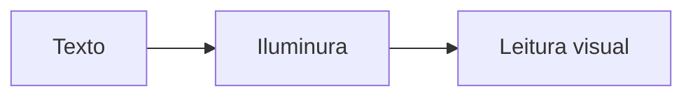

# exemplo.md

Documento de demonstração do **Iluminura**. Apague tudo e escreva o seu — ou abra outro arquivo com `Ctrl+O`.

## Texto

Um parágrafo comum com **negrito**, *itálico*, ***os dois***, ~~riscado~~, ==realçado==,
`código inline`, H~2~O e a famosa equação x^2^.

Escapes funcionam: \*não é itálico\* e \`não é código\`.

Uma quebra de linha
simples vira espaço. Duas espaços no fim forçam quebra:  
esta linha começa depois de um `<br>`.

## Listas

- Primeiro item
- Segundo item
  - Subitem aninhado
  - Outro subitem
- Terceiro item

1. Passo um
2. Passo dois
3. Passo três

- [x] Item concluído
- [ ] Item pendente

## Citação e alertas

> Uma citação simples, com **ênfase**.
>
> > E uma citação dentro da citação.

> [!TIP]
> Pressione `Ctrl+/` para alternar entre código-fonte e leitura.

> [!WARNING]
> O modo foco escurece tudo, menos o parágrafo onde está o cursor.

## Tabela

| Recurso | Estado | Atalho |
| :--- | :---: | ---: |
| Localizar | pronto | `Ctrl+F` |
| Modo foco | pronto | `Ctrl+Shift+F` |
| Diagramas | planejado | — |

## Código

```js
// destaque de sintaxe embutido
const iluminura = {
  nome: 'Iluminura',
  livre: true,
  dependencias: []
};

function saudacao(nome) {
  return `Olá, ${nome}!`;
}

console.log(saudacao(iluminura.nome));
```

```python
def fibonacci(n: int) -> list[int]:
    seq = [0, 1]
    while len(seq) < n:
        seq.append(seq[-1] + seq[-2])
    return seq

print(fibonacci(10))
```

## Diagramas



## Matemática

Em linha: $E = mc^2$, $\alpha + \beta = \gamma$ e $\sqrt{x^2 + y^2}$.

Em bloco:

$$
\frac{a}{b} = \frac{c}{d} \quad \text{e} \quad \sum_{i=1}^{n} x_i
$$

## Notas e referências

Uma afirmação com nota de rodapé[^fonte] e um link de referência para o [site do Markdown][md].

[^fonte]: O rodapé é recolhido no fim do documento.
[md]: https://commonmark.org "CommonMark"

---

Fim do exemplo.
